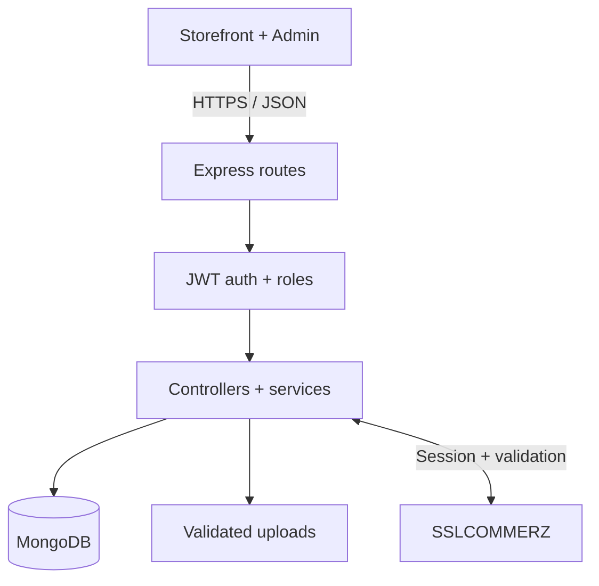
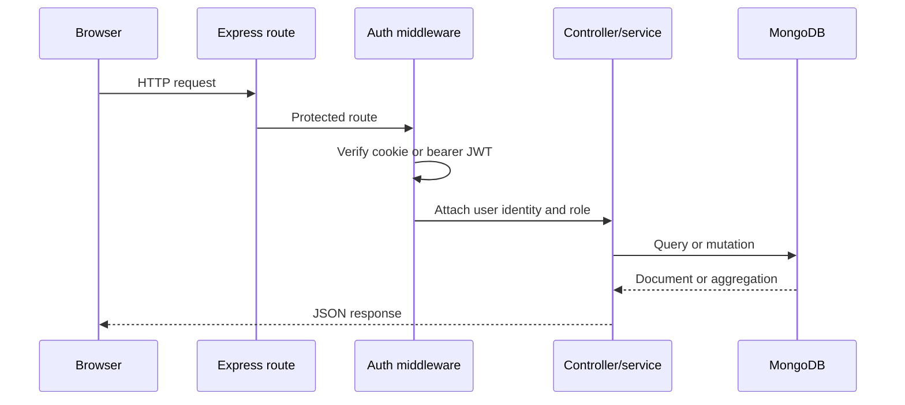
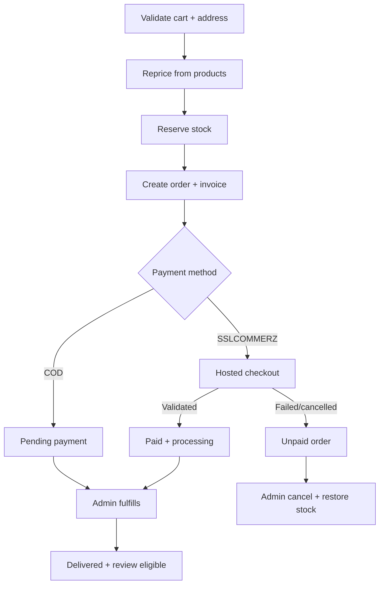

# Norda 2.12 — Architecture and Data Model

> Current extension: [Release automation, recovery and team inventory — 2.12](RELEASE_AUTOMATION.md). Adds the five selected infrastructure/security/inventory areas while retaining prior workflows.

## Coupons, wishlist, inventory and store content — 2.9.0

See [COMMERCE_TOOLS.md](COMMERCE_TOOLS.md) for implemented behavior, usage/limits, routes and acceptance scenarios. These four areas remain implemented. Sales reports, staff/customer management, device sessions, notification outcomes and selected-item returns/exchanges are now implemented in 2.10; see [MANAGEMENT_RETURNS.md](MANAGEMENT_RETURNS.md). The optional eCourier API, SEO, Cloudinary media and backup/monitoring tools are now implemented in 2.11; see [PRODUCTION_TOOLS.md](PRODUCTION_TOOLS.md) for configuration and live-account acceptance. Existing credentials/data are preserved.

## System view

`server/app.js` assembles middleware and routes without opening a port, which keeps composition testable. `server/server.js` validates the environment, connects MongoDB and then listens. Controllers translate HTTP input and output; services own totals, stock, invoice and gateway rules.

## API request flow

Public catalog routes bypass authentication. Protected routes call `protect`; operational routes call `protect` and `authorize(scope)`. Full-admin staff grants retain `adminOnly`. JWTs include a persisted device-session ID; authentication also checks revocation, expiry, token version and the current database permissions.

## Checkout and order lifecycle

Stock is reserved at order creation for both payment methods. A failed online payment therefore creates a visible unpaid order, matching the supplied operational flow. The administrator decides whether to investigate or cancel it. Direct status cancellation is restricted to unpaid pending/processing orders and restores each item once. The separate operations workflow adds approved paid cancellation with refund coordination, and paid delivered returns with physical receipt/restock decisions.

## Order and payment states

| Concern | States | Authority |
|---|---|---|
| Fulfillment | pending, processing, shipped, delivered, cancelled | Administrator, constrained by transition map |
| Order payment | pending, paid, failed, cancelled, review | Validated gateway callback/IPN, or administrator for COD only |
| Gateway transaction | initiated, paid, failed, cancelled, review, error | Payment service |
| Invoice payment | pending, paid, failed, cancelled, review | Synchronized from order payment state |

Keeping payment separate from fulfillment prevents a failed charge from appearing as a cancelled shipment and prevents a shipped order from implying that online payment was validated.

## Collections

| Collection | Key data and purpose |
|---|---|
| `users` | Identity, hashed password, role and default address |
| `categories` | Managed catalog grouping and unique slug |
| `brands` | Managed name/slug, description, optional logo and visibility |
| `products` | Catalog content, current prices, stock, category, brand reference/name snapshot, images and rating aggregates |
| `carts` | One customer-owned set of product, quantity and refreshed price lines |
| `orders` | Customer, immutable line snapshots, address, totals, fulfillment/payment states and cancellation/restock metadata |
| `invoices` | One-per-order immutable billing snapshot and synchronized payment state |
| `payments` | Gateway transaction, expected amount/currency, validation metadata, risk and outcome |
| `orderrequests` | Customer cancellation/whole-order return requests, decisions, receipt and restock metadata |
| `refunds` | Replay-safe source-charge ledger, reserved/completed balance, provider references and reconciliation state |
| `orderevents` | Append-only API audit of new administrator/request/refund decisions; private to administrators |
| `shipmentevents` | Append-only courier/progress snapshots, request replay key and private administrator actor |
| `ordernotifications` | Durable order email payload, commit activation, atomic delivery claim, retry and transport state |
| `reviews` | Unique customer/product review, rating, comment and verified-purchase flag |
| `uploads` | Stored-file metadata and administrator ownership |

## Important integrity choices

- Product `brandRef` is authoritative for filtering; `brand` retains the display snapshot needed by older data.
- Order and invoice lines are embedded because they belong to exactly one historical purchase and must not change with the catalog.
- Prices, totals, roles, paid state and transaction IDs are server-controlled.
- Product stock reservation uses conditional decrement (`stock >= requested quantity`) per line.
- If an order attempt fails after partial reservation, completed decrements are compensated.
- Cancellation claims `stockRestored: false` before incrementing inventory; repeat requests cannot restore twice.
- CSV output quotes all cells and prefixes formula-like cells.

## Deployment topology

The recommended v2 topology is one Express origin serving both `client/` and `/api`. It simplifies cookies and CORS. If the static client is hosted separately, set `window.NORDA_API_URL`, allow the exact client origin in `CLIENT_URL`, use HTTPS, review cookie `SameSite` policy and test credentials end to end.

For production, replace local `server/uploads` with durable object storage and a malware/image-processing pipeline. Run the API behind TLS, use a managed MongoDB replica set, centralize logs and metrics, and keep secrets in the deployment platform rather than files.

## Version 2.1 reliability changes

`OperationLock` documents coordinate work across API processes. Cart/checkout operations share `cart:<user>`; payment capture and cancellation share `order:<order>`. Locks have owner tokens, a renewable lease and expiry cleanup.

`databaseUnit` selects native transactions when MongoDB reports a replica set/sharded topology. Standalone local MongoDB uses reverse-order compensations. These cover handled errors; a replica set is still necessary for atomic process-crash recovery.

Checkout keys are unique per customer through a partial index. Successful replay returns the original order/invoice. Order creation clears the cart last. Historical catalog references survive product archive actions.

`review` is an explicit order/invoice payment state. A late validated payment can have `isPaid:true` (funds validated) while cancellation and restored inventory stay intact; `paymentStatus:review` prevents fulfillment and tells operators to resolve the payment. Gateway risk review has `isPaid:false`.

No external gateway call runs inside a MongoDB transaction. Test model adapters live under `test-support/` and are never imported by application composition.

## Version 2.6 checkout recovery

Orders carry `reservationExpiresAt`, `reservationExpiredAt` and the first `paidTransactionId`. A server-owned startup/periodic worker expires eligible unpaid online orders; legacy orders derive the deadline from `createdAt`. COD, paid and review states are excluded. Records are retained; no TTL deletion is used.

Expiry, retries, cancellation and callback capture share the existing distributed order lock. Retry queries all real payment attempts outside database transactions, validates successful remote rows, resumes a pending hosted session or records a new unique attempt after a confirmed terminal outcome. Expired reservations re-check/re-reserve each product inside the existing transaction/compensation unit. The order, invoice, price/address snapshots and a newer cart remain intact. Payment rows have optional per-order unique retry keys; old attempt failures cannot overwrite the current attempt. Late or multiple successful charges require sticky review. Details: [CHECKOUT_RECOVERY.md](CHECKOUT_RECOVERY.md).

## Version 2.7 order operations

`orderRequestService` owns customer eligibility, decisions and return receipt. `paymentReviewService` verifies captured history, retains a canonical charge and resolves review with explicit risk acknowledgement. `verifiedPayments` isolates strict gateway/source verification. `refundService` owns the charge-capped ledger, provider submission/query, cash receipts and startup/30-second reconciliation worker. Shared helpers in `orderOperationStore` synchronize order/invoice summaries, audit and stock restoration inside the existing database unit.

The lock `order:<id>` serializes these operations with callbacks, reservation expiry, payment retry and fulfillment. Database writes stay inside transactions or registered compensations; provider network calls remain outside database transactions. A durable `submitting` refund state is committed before the network boundary. Interrupted/uncertain submissions reserve balance and require existing-reference reconciliation instead of a blind retry.

Cancellation and return state are separate from fulfillment; a received return preserves delivered history. Refund state is separate from paid history and immutable original invoice totals. `settledPayment` plus validation/bank references identifies the retained sale; extra-charge refunds are counted separately. Customer endpoints return public projections; administrator endpoints add transaction/audit detail while omitting hosted-session secrets. See [ORDER_OPERATIONS.md](ORDER_OPERATIONS.md) for states, API and acceptance.

## Version 2.8 courier, email and option inventory

Products embed retained size/color options. A partial unique multikey SKU index enforces uniqueness across products; service validation rejects duplicate combinations within one product. `inventoryService` reserves/restores a selected option plus product total in one atomic document update. Every stock write increments an inventory revision so full option edits cannot overwrite a concurrent sale. Ordered simple products cannot switch to variant mode; existing options are retired rather than deleted. Cart/order/invoice items carry stable option IDs and snapshot labels/prices.

`shipmentService` validates courier details, HTTPS links, replay keys and forward progress. Shipment events, order/COD state, invoice synchronization and staged emails share the existing order lock/database unit. The customer tracking endpoint returns public projections with paginated history; administrator actor/request metadata stays private.

`notificationService` stages durable held records inside the database unit. New `afterCommit` hooks activate them after the transaction/compensated operation succeeds; failed activation can be recovered by the worker. Provider calls run outside commerce transactions. Atomic sending claims, bounded exponential retry and stable Message-ID provide at-least-once SMTP delivery. Existing account SMTP/file transport is reused with optional message IDs, and local account/order previews are filtered separately. The API starts/stops all three workers with its existing lifecycle. See [DELIVERY_NOTIFICATIONS.md](DELIVERY_NOTIFICATIONS.md) and [PRODUCT_VARIANTS.md](PRODUCT_VARIANTS.md).

## 2.10 management collections and coordination

`AuthSession` stores session IDs, expiry/version, revocation and masked device metadata; legacy tokens are adopted by hash. `StaffAudit` records full-admin grants. `ItemReturnCase` records immutable selected lines/unit ordinals, decisions, receipt and replacement shipment. `CreditNote` records invoice adjustments without replacing original totals. Refund `awaiting_return` holds reserve the source balance until physical receipt. `NotificationDeliveryEvent` is an append-only provider/manual outcome history, separate from SMTP acceptance; preferences are checked before staging/sending.

Item cases/refunds/exchanges share the existing `order:<id>` lock and database unit. Access grants plus audit and sign-out-other-session rotations also use transaction/compensation units. No external SMTP/gateway call runs inside a database transaction. See [MANAGEMENT_RETURNS.md](MANAGEMENT_RETURNS.md) for report definitions and policy boundaries.

## Production operations — 2.11

New `CourierBooking` and `CourierEvent` records coordinate one external parcel with existing order locks, transaction/compensation units, fulfillment, COD payment, invoice snapshots and notification outbox. External create/cancel uncertainty remains durable and reconciles by the original reference. Booking metadata does not imply pickup.

The `Upload` record retains local identities while tracking optional Cloudinary ownership/lifecycle. Guarded catalog/settings writes and cleanup share a reference lock. SEO HTML is generated before static hosting without changing browser product behavior.

`MaintenanceGate` coordinates mutation/worker leases across upgraded application processes; backup drains writers before BSON/media capture. `BackupRun` records outcomes; `.ndb` authenticated archives restore only into a new target. `OperationalEvent` stores bounded redacted incidents/alert claims, and readiness separates liveness from database/maintenance status. See [production boundaries](PRODUCTION_TOOLS.md) for other writers, media recovery, provider contracts and off-host operations.

## Release/team/inventory coordination — 2.12

`MfaChallenge` binds a hashed opaque login attempt to the current user token/MFA revision. Encrypted user enrollment/secret fields and hashed recovery codes are private selections; security changes compare current versions and rotate sessions. `AuthSession.mfaVerifiedRevision` prevents password-only/earlier tokens being accepted for MFA accounts. Staff invitations coordinate existing-user ownership, one-use tokens and staff audit under the existing staff-management lock.

`Warehouse` and `WarehouseStock` hold satellite inventory. `InventoryMovement` records request-key replay and reasons; transfers atomically move existing online SKU stock versus satellite balances using transaction/compensation units. The storefront still reads online stock. `CatalogImport` retains one previewed creation result; managed-media locks protect its references. `StockSubscription`/`StockNotice` implement permission-aware shortage episodes and out-of-transaction SMTP claims/retry.

`OffsiteBackup` tracks one encrypted local archive/destination/key/hash and readback confirmation. `RestoreDrill` records isolated target creation/cleanup. These telemetry records and transient MFA challenges are omitted from backup restore; warehouse, catalog and account records are retained. Independent monitoring persists only its safe transition state outside application MongoDB. Deployment code/data/secrets are separated on the target VM; rollback retains live database/media state.

## Advanced operations — 2.14

`LogisticsJob` persists each parcel/pickup booking attempt before outbound work. Order/job locks coordinate submission, carrier cancellation and authenticated tracking. A timeout retains the reference as unknown; the worker queries it rather than resending. Forward parcels use the existing eCourier adapter; reverse bookings use the explicitly configured merchant connector. Physical warehouse receipts remain independent of carrier tracking.

`StatementFeed` retains an opaque cursor and pending `StatementRun`. A fetched page is durably staged before review/automatic ledger import. A deterministic settlement batch key survives a lost local response, and only identical immutable provider references are skipped. Feed cursors advance after recorded imports/empty pages. Accounting CSV derives balanced journals from matched/accepted ledger records; it never confirms payment.

`WholeReturnReceipt` holds physical line/quantity/location decisions. `ReturnRules` are snapshotted on the request. Complete receipt creates `WholeReturnCredit` and queues the calculated existing refund; confirmed success settles the credit and request even when the invoice is only partly refunded due to deductions. Original invoice totals do not change. Existing item receipts additionally support explicit receiving warehouses.

`RoutingSettings` adds district-centre coordinates and distance/capacity/balanced ranking to existing fulfillment priorities. Each satellite warehouse stores an atomic capacity guard against open reservation units. `WarehouseBatch` makes previewed sequential transfer rows replay-safe under the shared movement lock and database unit. Existing paid-order allocations and parcel IDs are never rerouted. These collections are included by the existing collection-discovery backup mechanism.
